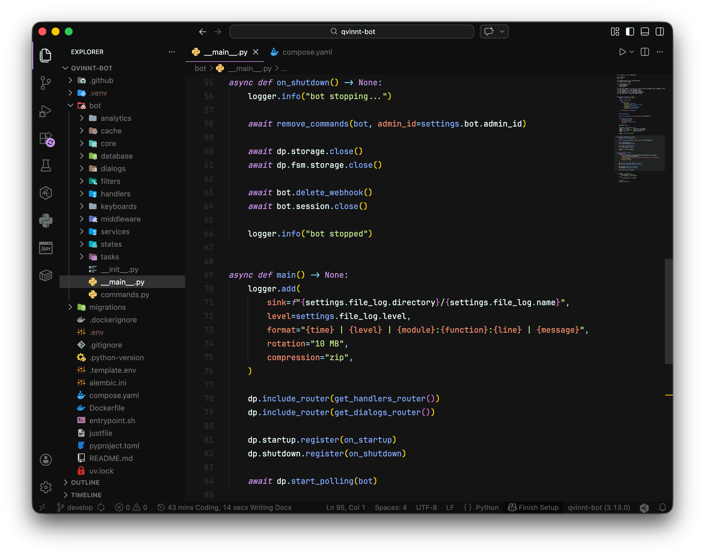

<div align="center">

# TimNekk Theme

**Deep charcoal. Soft colors. A little purple.**

A personal dark theme for Visual Studio Code, inspired by Material Darker Theme.

[VS Code Marketplace](https://marketplace.visualstudio.com/items?itemName=TimNekk.timnekk-theme) · [Open VSX](https://open-vsx.org/extension/TimNekk/timnekk-theme) · [Releases](https://github.com/TimNekk/timnekk-theme/releases)

</div>



## The look

A near-black editor with a quieter sidebar, pastel syntax colors, and purple accents throughout the interface. Italic keywords give the code a little character, while matching terminal and Git colors keep the workspace consistent.

- **Charcoal surfaces** — `#141414` in the editor and `#0f0f0f` around it.
- **Pastel syntax** — green strings, blue functions, and purple keywords.
- **Subtle details** — muted comments, soft selections, and understated borders.
- **Matching terminal colors** — the same palette for ANSI colors.
- **Git at a glance** — distinct colors for new, modified, renamed, deleted, and conflicting files.

## Install

Find **TimNekk Theme** in the Extensions panel, or install it from the command line:

```sh
code --install-extension TimNekk.timnekk-theme
```

Open the Command Palette, run **Preferences: Color Theme**, and select **TimNekk Dark**.

For editors that use Open VSX, install it from the [Open VSX listing](https://open-vsx.org/extension/TimNekk/timnekk-theme). You can also download a `.vsix` from [GitHub Releases](https://github.com/TimNekk/timnekk-theme/releases) and run **Extensions: Install from VSIX…**.

Requires VS Code **1.87.0 or newer**. The theme controls colors and token styles; the font and file icons in the preview are configured separately.

## Palette

| Color | Hex | Used for |
| --- | --- | --- |
| Charcoal | `#141414` | Editor background |
| Near-black | `#0f0f0f` | Sidebar and tabs |
| Off-white | `#eeffff` | Default text |
| Green | `#c3e88d` | Strings |
| Blue | `#82aaff` | Functions |
| Purple | `#c792ea` | Keywords and interface accents |
| Cyan | `#89ddff` | Punctuation |
| Yellow | `#ffcb6b` | Warnings |
| Coral | `#f07178` | Tags and errors |

## Git colors

File decorations use the same palette as the code. New files share the green used for strings.

| Status | Color | Hex |
| --- | --- | --- |
| Untracked / added | Green | `#c3e88d` |
| Modified / staged modified | Cyan | `#89ddff` |
| Renamed | Purple | `#c792ea` |
| Deleted / staged deleted | Coral | `#f07178` |
| Conflicting | Yellow | `#ffcb6b` |
| Ignored | Muted brown | `#785d52` |
| Submodule | Blue | `#82aaff` |

If file colors are missing, make sure `git.decorations.enabled` and `explorer.decorations.colors` are enabled in your editor settings.

## Make it yours

Override individual colors in `settings.json` without editing the extension:

```jsonc
{
  "workbench.colorCustomizations": {
    "[TimNekk Dark]": {
      "editor.background": "#141414",
      "gitDecoration.untrackedResourceForeground": "#c3e88d"
    }
  }
}
```

## Local development

1. Clone this repository and open it in VS Code.
2. Press **F5** to launch the configured Extension Development Host.
3. Select **TimNekk Dark** in the new window and open a project to preview it.
4. Edit [`themes/TimNekk-dark-color-theme.json`](./themes/TimNekk-dark-color-theme.json) to adjust the palette.

To build an installable extension:

```sh
npm ci
npx vsce package
```

## Credits & license

Created by [TimNekk](https://github.com/TimNekk), inspired by Material Darker Theme.

Licensed under [MIT](./LICENSE.md).
